# WeFlow · 微信公众号 AI 写作助手

输入一句话，让 AI 完成选题、素材整理、成稿、配图、排版与发布前自检，最后把文章送进微信公众号草稿箱。

WeFlow 是一个本地运行的微信公众号创作工作台：后端 FastAPI + SQLite，前端 React + Vite。它不替你做最终发布决定，但会把重复劳动压缩成一条可视化的任务流水线，并保留人工审核环节。

项目基于 [Apache License 2.0](LICENSE) 开源。使用本项目即表示你已阅读并同意文末的[免责声明](#免责声明)。

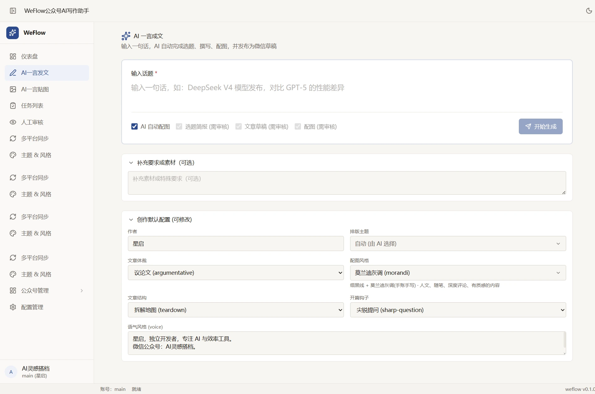

> 截图取自真实运行环境，账号名、作者与文章标题均为实际数据；App ID、API Key、同步 Token、本地路径与素材 ID 已在界面或截图时掩码。

## 目录

- [主要功能](#主要功能)
- [界面预览](#界面预览)
- [工作流程](#工作流程)
- [开发环境部署与启动](#开发环境部署与启动)
- [生产环境部署](#生产环境部署)
- [配置说明](#配置说明)
- [使用示例](#使用示例)
- [产物与数据](#产物与数据)
- [项目结构](#项目结构)
- [常见问题](#常见问题)
- [安全与使用边界](#安全与使用边界)
- [免责声明](#免责声明)
- [参与贡献](#参与贡献)
- [许可证](#许可证)

## 主要功能

| 能力 | 说明 |
| --- | --- |
| AI 一言成文 | 输入一个话题，自动生成选题简报、研究素材、文章初稿、配图、排版 HTML，并发布到公众号草稿箱 |
| AI 一言贴图 | 输入一个话题，生成 5-10 张信息图卡片和一段短描述，发布为微信公众号图片消息 |
| 多账号人格 | 每个公众号可独立配置作者、语气（voice）、排版主题、配图风格与默认同步平台 |
| 15 套排版主题 | `refined-blue`、`minimal-mono`、`news-bold`、`ink-wash`、`magazine-grid` 等，适配 AI 分析、技术、新闻、人文、生活等题材 |
| 22 套配图风格 | 手绘蓝调、马克笔金句卡、手绘水彩信息图、数据图表、杂志编辑风等 |
| 分段人工审核 | 选题简报、文章草稿、配图三个节点可独立开启审核；审核通过后才继续执行 |
| 配图审核 | 在审核页查看提示词、替换图片或按新提示词重新生成 |
| AI 味自检 | 从句式、措辞、词汇、结构、标点等维度打分，总分达到阈值会被拦截；用于降低模板化表达，不能保证通过任何第三方检测 |
| 任务时间线 | 每个阶段都有状态记录、耗时、产物路径与失败原因；支持断点重试 |
| 配置管理 | 在 Web 界面管理公众号账号、大模型、生图模型、主题、风格和同步 Token |
| 公众号素材管理 | 查看、上传、删除公众号永久素材 |
| 多平台同步（可选） | 基于第三方 Wechatsync，把同一篇文章同步到知乎、掘金、CSDN 等平台，默认不启用 |
| 本地优先 | 数据保存在本机 SQLite 与 `generated/` 目录，不依赖云端存储 |

## 界面预览

### AI 一言成文

输入话题、补充素材，按需勾选「选题简报 / 文章草稿 / 配图」审核，然后开始生成。


### AI 一言贴图

同一套工作流也可以产出图片消息：先生成简报和卡片计划，再批量生成信息图卡片。

<table>
<tr>
<td width="50%">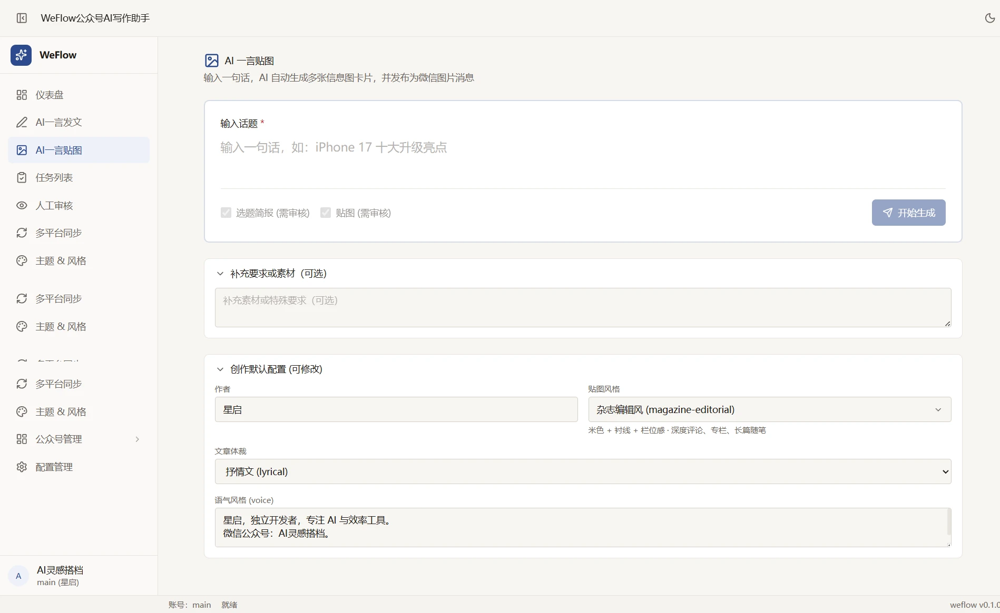</td>
<td width="50%">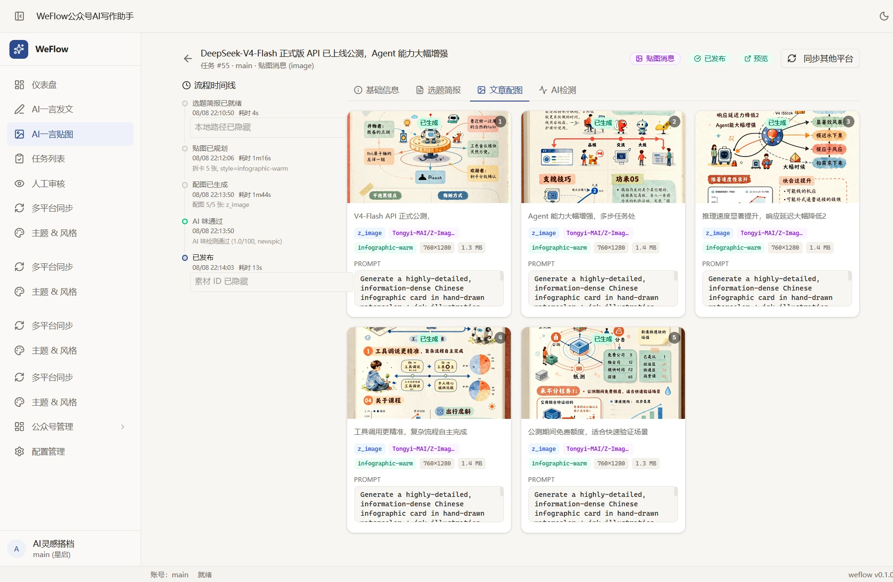</td>
</tr>
</table>

### 人工审核

审核队列集中展示待审任务；审核详情页可以查看配图、提示词和生成参数，并直接替换或重新生成。

<table>
<tr>
<td width="50%">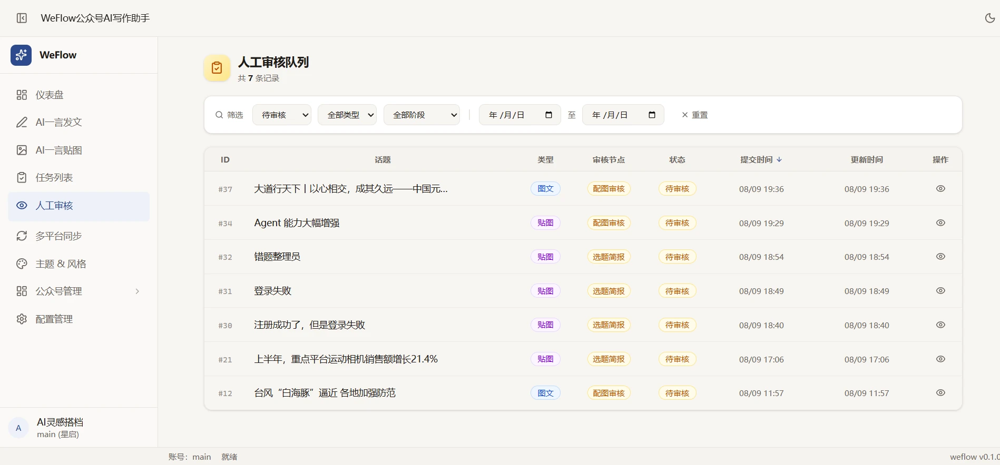</td>
<td width="50%">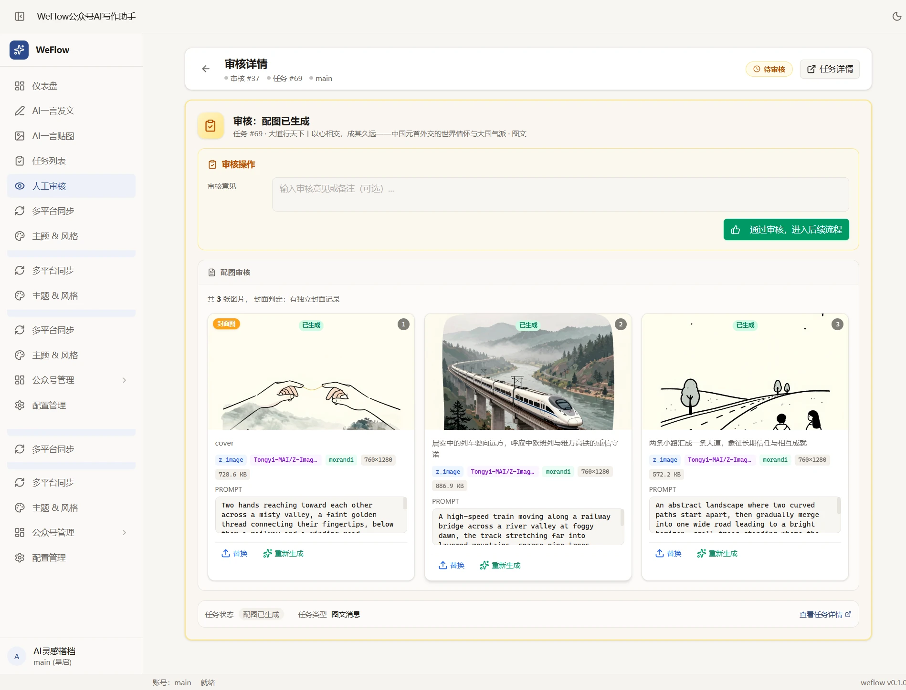</td>
</tr>
</table>

### 主题与风格

排版主题和配图风格都可以在界面中预览、切换；每个账号可设置默认值。

<table>
<tr>
<td width="50%">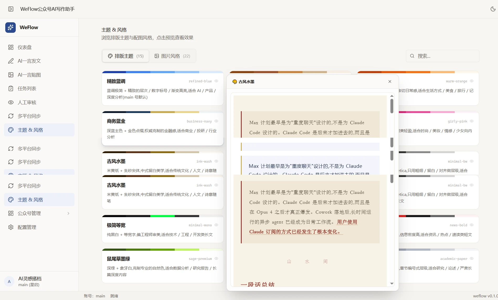</td>
<td width="50%">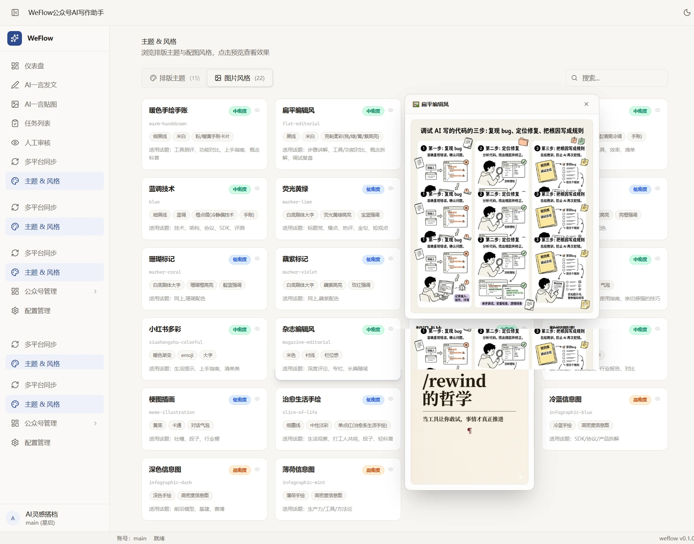</td>
</tr>
</table>

### 任务详情与 AI 味自检

任务时间线记录每个阶段的耗时与产物；AI 味自检展示总分、阈值和各维度得分。

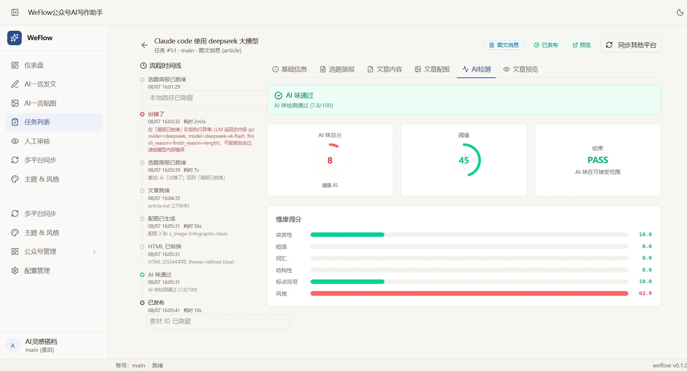

### 配置管理

集中管理公众号账号、默认 Provider、模型、API Key、Base URL、主题、风格与同步 Token。界面中的密钥默认脱敏显示。

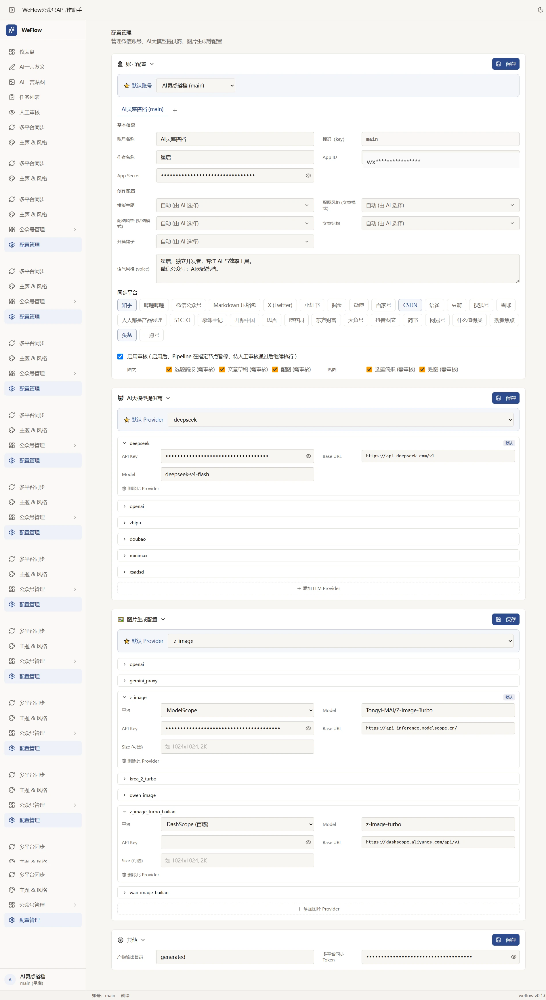

## 工作流程

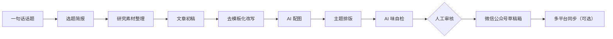

几个关键约定：

- 文章只会进入公众号**草稿箱**，不会自动群发；最终发布需要在公众平台手动确认。
- 审核节点可以在「配置管理」中按账号开启，并分别选择「选题简报 / 文章草稿 / 配图」。
- AI 味自检在发布前强制执行；未通过时需要回到改写环节重试。
- 多平台同步是可选能力，需要单独安装第三方 CLI 并配置 Token，不影响微信草稿流程。

## 开发环境部署与启动

开发环境由两个进程组成：Vite 提供前端开发服务器（热更新），FastAPI 提供 API（代码变更自动重载）。两者都只监听本机，数据写入项目目录下的 SQLite 和 `generated/`。

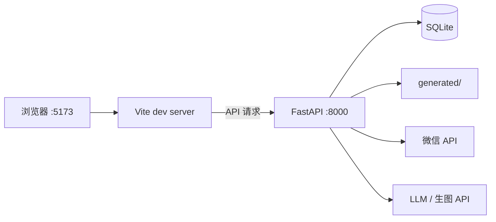

开发环境与生产环境的差异：

| 项目 | 开发环境 | 生产环境 |
| --- | --- | --- |
| 前端 | Vite dev server，端口 5173，支持 HMR | `npm run build` 产物，由 Nginx 提供 |
| 后端 | `uvicorn --reload`，本机 8000 | systemd 托管，`--workers 1` |
| API 地址 | 浏览器直连 `http://localhost:8000/api/v1` | 同域 `/api/v1`，由 Nginx 反向代理 |
| CORS | 默认只允许 `localhost:5173` / `127.0.0.1:5173` | 配置为实际域名 |
| HTTPS / 认证 | 无，仅本机访问 | HTTPS + Nginx Basic Auth（或 VPN / IP 白名单） |
| 适用场景 | 本地开发、调试、验证功能 | 长期在线使用，见[生产环境部署](#生产环境部署) |

### 环境要求

- Python 3.10+（推荐 3.11）
- Node.js 20.19+ 或 22.12+（Vite 8 要求）
- npm 10+
- Windows 10/11、macOS 或 Linux

确认版本：

```bash
python --version
node -v
npm -v
```

### 1. 获取代码

```bash
git clone https://github.com/chengwind198/WechatFlow.git
cd WechatFlow
```

### 2. 创建配置文件

```bash
cp config.yaml.example config.yaml
```

Windows CMD：

```bat
copy config.yaml.example config.yaml
```

配置文件固定读取项目根目录的 `config.yaml`，与启动时所在目录无关。至少需要填写：

- `accounts.<name>.app_id` / `app_secret`
- `llm_providers.providers.<provider>.api_key`
- `image_generation.<provider>.api_key`

`config.yaml` 已被 `.gitignore` 忽略，不要把真实密钥提交到仓库。建议限制权限：

```bash
chmod 600 config.yaml
```

### 3. 安装并启动后端

在仓库根目录执行：

```bash
cd backend
python -m venv .venv
```

Windows：

```bat
.venv\Scripts\activate
```

macOS / Linux：

```bash
source .venv/bin/activate
```

安装依赖并启动开发服务器：

```bash
pip install -r requirements.txt
python -m uvicorn app.main:app --reload --host 127.0.0.1 --port 8000
```

`--reload` 会在 Python 文件变更后自动重启。启动后验证：

```bash
curl http://127.0.0.1:8000/api/v1/health
```

预期返回 `engine_accessible` 为 `true`：

```json
{"code":0,"message":"ok","data":{"status":"healthy","engine_accessible":true}}
```

也可以打开 <http://127.0.0.1:8000/docs> 查看接口文档。

### 4. 安装并启动前端

另开一个终端：

```bash
cd frontend
npm install
npm run dev
```

打开终端输出的地址，默认是 <http://127.0.0.1:5173>。端口被占用时 Vite 会自动改用 5174 等端口，此时需要把新地址加入 `CORS_ORIGINS`，否则浏览器会拦截 API 请求。

前端默认请求 `http://localhost:8000/api/v1`，后端默认允许 `http://localhost:5173` 和 `http://127.0.0.1:5173` 跨域。两者端口保持默认即可直接联调。

### 5. 验证开发环境

1. 打开 <http://127.0.0.1:5173>，能正常进入首页。
2. 进入「配置管理」，确认账号、模型和生图 Provider 已从 `config.yaml` 读取；点击「保存」，确认写回成功。
3. 创建一条测试任务，观察任务时间线是否依次推进；如果配置了真实密钥，确认能生成配图和草稿。
4. 修改任意后端 `.py` 或前端 `.tsx` 文件，确认前后端都能自动重载。

### 6. 常用开发命令

| 命令 | 所在目录 | 说明 |
| --- | --- | --- |
| `python -m uvicorn app.main:app --reload --host 127.0.0.1 --port 8000` | `backend/` | 启动后端开发服务器 |
| `npm run dev` | `frontend/` | 启动前端开发服务器（HMR） |
| `npm run lint` | `frontend/` | 运行 oxlint 检查 |
| `npm run build` | `frontend/` | 类型检查并构建到 `frontend/dist/` |
| `npm run preview` | `frontend/` | 本地预览构建产物 |
| `python -m pytest tests -q` | 仓库根目录 | 运行后端测试，需先 `pip install pytest` |

> 测试目录仍在适配当前项目结构，部分用例可能失败；以实际输出为准，不要把它当作发布门禁。

### 7. 开发环境变量

| 变量 | 默认值 | 作用 |
| --- | --- | --- |
| `VITE_API_BASE_URL` | `http://localhost:8000/api/v1` | 前端请求的 API 地址，在构建或开发启动时读取 |
| `CORS_ORIGINS` | `http://localhost:5173,http://127.0.0.1:5173` | 后端允许的跨域来源，多个用逗号分隔 |
| `GENERATED_TASK_DIR` | `generated` | 任务产物目录，相对路径基于项目根目录解析 |
| `HOST` / `PORT` | `127.0.0.1` / `8000` | 生成文件 URL 中使用的地址，应与实际监听地址一致 |
| `LOG_LEVEL` | `info` | 后端日志级别 |

后端从**启动时所在目录**的 `.env` 读取这些变量，因此推荐按上文在 `backend/` 目录启动，并把 `.env` 放在 `backend/.env`。前端可在 `frontend/.env.local` 中设置 `VITE_API_BASE_URL`，该文件同样不会被提交。

### 8. 停止服务

手动启动时，在各终端按 `Ctrl+C`。使用一键脚本时：

```bat
scripts\stop-all.bat
```

macOS / Linux：

```bash
bash scripts/stop-all.sh
```

也可以按端口手动结束进程：

```bash
# macOS / Linux
lsof -ti:8000,5173 | xargs kill
```

```powershell
# Windows PowerShell
Get-NetTCPConnection -LocalPort 8000,5173 -State Listen |
  ForEach-Object { Stop-Process -Id $_.OwningProcess -Force }
```

### 9. Windows 一键启动脚本

```bat
scripts\start-all.bat
```

脚本会分别启动后端和前端，日志写入 `logs/`。启动前会检查并结束占用 `8000` / `5173` 端口的进程；如果这两个端口上有其他重要服务，请改用手动命令。

仓库同时提供面向 Git Bash / macOS / Linux 的 `scripts/start-all.sh` 和 `scripts/stop-all.sh`。这些脚本依赖端口检测与进程结束命令，跨平台行为不完全一致，遇到问题以上述手动步骤为准。

### 10. 开发环境排错

| 现象 | 可能原因 | 处理 |
| --- | --- | --- |
| 后端提示「未找到 config.yaml」或「accounts 为空」 | 配置文件缺失或内容为空 | 在项目根目录创建 `config.yaml` 并至少填写一个账号 |
| 前端报 CORS 错误或 `Failed to fetch` | 前端端口变化，或 `CORS_ORIGINS` 未包含实际来源 | 把实际地址加入 `CORS_ORIGINS` 后重启后端 |
| 5173 被占用，前端自动换端口 | Vite 默认不强制端口 | 使用终端显示的新地址，并同步更新 CORS |
| 健康检查 `engine_accessible: false` | 后端依赖不完整或目录不匹配 | 确认从 `backend/` 启动，并重新安装 `requirements.txt` |
| `.env` 中的配置不生效 | `.env` 不在启动目录 | 从 `backend/` 启动，或把 `.env` 放到该目录 |
| `npm install` 或 `npm run dev` 报 Node 版本错误 | Node 低于 20.19 / 22.12 | 升级 Node 后重新安装依赖 |
| 配置页保存失败 | `config.yaml` 只读或权限不足 | 检查文件属主与写权限 |
| 任务卡在生图或草稿阶段 | API Key、Base URL 或微信 IP 白名单不正确 | 查看任务时间线中的失败原因，核对 Provider 配置 |

### 11. 构建前端产物

```bash
cd frontend
npm run build
```

构建产物在 `frontend/dist/`。构建时通过 `VITE_API_BASE_URL` 指定 API 地址：

```bash
VITE_API_BASE_URL=http://127.0.0.1:8000/api/v1 npm run build
```

如果要部署到服务器并由 Nginx 反代 API，使用同域路径 `VITE_API_BASE_URL=/api/v1`，具体见下一节。

## 生产环境部署

下面是一套常见的 Linux 单机部署方案：Nginx 提供前端静态文件和 HTTPS，FastAPI 只监听本机，SQLite 与生成产物放在项目目录。适合个人或小团队长期使用。

> **重要：应用没有内置登录和权限系统。** 部署到公网时，必须在 Nginx 层加访问控制（Basic Auth、VPN 或 IP 白名单），否则任何拿到地址的人都能调用生成、配置和发布接口。只给自己用时，更推荐 Tailscale / WireGuard / SSH 隧道，不要直接暴露公网。

下面是一套常见的 Linux 单机部署方案：Nginx 提供前端静态文件和 HTTPS，FastAPI 只监听本机，SQLite 与生成产物放在项目目录。适合个人或小团队长期使用。

> **重要：应用没有内置登录和权限系统。** 部署到公网时，必须在 Nginx 层加访问控制（Basic Auth、VPN 或 IP 白名单），否则任何拿到地址的人都能调用生成、配置和发布接口。只给自己用时，更推荐 Tailscale / WireGuard / SSH 隧道，不要直接暴露公网。

### 部署架构

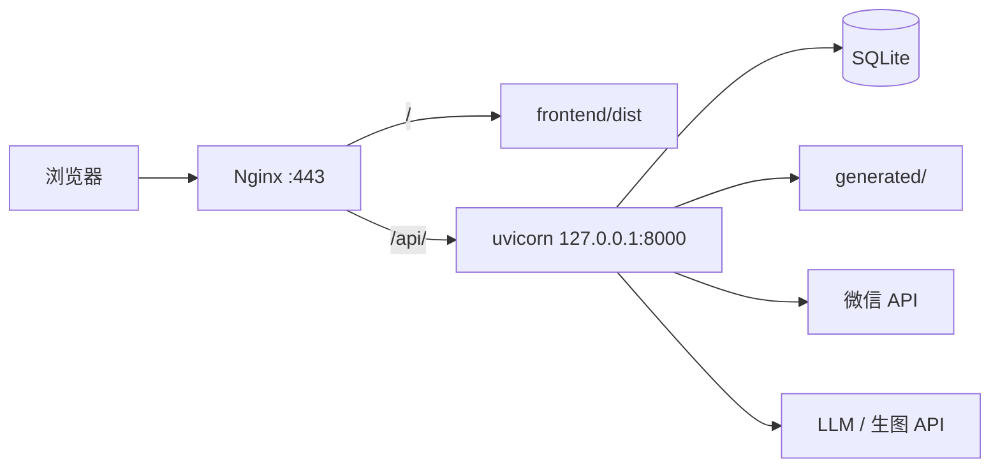

### 1. 服务器准备

以 Ubuntu 22.04 / 24.04 为例，建议至少 2 核 4G 内存：

```bash
sudo apt update
sudo apt install -y python3 python3-venv python3-pip nginx apache2-utils git
```

Node.js 请安装 20.19+ 或 22.12+（Vite 8 的要求），可以用 nvm 或 NodeSource，安装后确认：

```bash
node -v
npm -v
```

### 2. 拉取代码并创建运行用户

```bash
sudo useradd --system --create-home --shell /usr/sbin/nologin weflow
sudo git clone https://github.com/chengwind198/WechatFlow.git /opt/weflow
sudo chown -R weflow:weflow /opt/weflow
sudo -u weflow -H mkdir -p /opt/weflow/generated /opt/weflow/logs
```

### 3. 创建配置

```bash
sudo -u weflow -H cp /opt/weflow/config.yaml.example /opt/weflow/config.yaml
sudo -u weflow -H chmod 600 /opt/weflow/config.yaml
sudo -u weflow -H nano /opt/weflow/config.yaml
```

至少填写：

- `accounts.<name>.app_id` / `app_secret`
- `llm_providers.providers.<provider>.api_key`
- `image_generation.<provider>.api_key`

配置里的 `generated_task_dir` 可以保持 `generated`，它会解析到 `/opt/weflow/generated`。

### 4. 安装后端依赖

```bash
sudo -u weflow -H bash -lc '
  cd /opt/weflow/backend
  python3 -m venv .venv
  .venv/bin/pip install --upgrade pip
  .venv/bin/pip install -r requirements.txt
'
```

先手动启动一次，确认配置和目录权限正常：

```bash
sudo -u weflow -H bash -lc '
  cd /opt/weflow/backend
  .venv/bin/python -m uvicorn app.main:app --host 127.0.0.1 --port 8000
'
```

访问 `http://127.0.0.1:8000/api/v1/health`，应返回 `engine_accessible: true`。确认后按 `Ctrl+C` 停止。

### 5. 注册 systemd 服务

创建 `/etc/systemd/system/weflow.service`：

```ini
[Unit]
Description=WeFlow backend
After=network-online.target
Wants=network-online.target

[Service]
Type=simple
User=weflow
Group=weflow
WorkingDirectory=/opt/weflow/backend
Environment=PYTHONUTF8=1
Environment=PYTHONIOENCODING=utf-8
Environment=CORS_ORIGINS=https://your-domain.example
ExecStart=/opt/weflow/backend/.venv/bin/python -m uvicorn app.main:app --host 127.0.0.1 --port 8000 --workers 1 --proxy-headers --forwarded-allow-ips=127.0.0.1
Restart=on-failure
RestartSec=5

[Install]
WantedBy=multi-user.target
```

说明：

- `CORS_ORIGINS` 改成实际前端地址；多个地址用逗号分隔。
- 建议保持 `--workers 1`。任务在进程内执行，SQLite 也不适合多进程高并发写入。
- `--proxy-headers` 让后端正确识别 Nginx 转发的真实 IP。

启用并启动：

```bash
sudo systemctl daemon-reload
sudo systemctl enable --now weflow
sudo systemctl status weflow
sudo journalctl -u weflow -f
```

### 6. 构建前端

```bash
sudo -u weflow -H bash -lc '
  cd /opt/weflow/frontend
  npm ci
  VITE_API_BASE_URL=/api/v1 npm run build
'
```

`VITE_API_BASE_URL=/api/v1` 表示前端和 API 走同一个域名，由 Nginx 把 `/api/` 转发到后端。

### 7. 配置 Nginx

创建 `/etc/nginx/sites-available/weflow`：

```nginx
server {
    listen 80;
    server_name your-domain.example;

    client_max_body_size 20m;

    root /opt/weflow/frontend/dist;
    index index.html;

    location / {
        try_files $uri $uri/ /index.html;
    }

    location /api/ {
        proxy_pass http://127.0.0.1:8000;
        proxy_http_version 1.1;
        proxy_set_header Host $host;
        proxy_set_header X-Real-IP $remote_addr;
        proxy_set_header X-Forwarded-For $proxy_add_x_forwarded_for;
        proxy_set_header X-Forwarded-Proto $scheme;
        proxy_read_timeout 300s;
        proxy_send_timeout 300s;
    }

    # 应用没有内置认证，公网部署至少加一层访问控制
    auth_basic "WeFlow";
    auth_basic_user_file /etc/nginx/.htpasswd;
}
```

创建访问密码并启用站点：

```bash
sudo htpasswd -c /etc/nginx/.htpasswd weflow
sudo ln -s /etc/nginx/sites-available/weflow /etc/nginx/sites-enabled/weflow
sudo nginx -t
sudo systemctl reload nginx
```

`client_max_body_size` 和 `proxy_read_timeout` 可以按图片大小、生图耗时调整。

### 8. 配置 HTTPS

先把域名 A 记录指向服务器，开放 80 / 443 端口，然后：

```bash
sudo apt install -y certbot python3-certbot-nginx
sudo certbot --nginx -d your-domain.example
```

如果 Certbot 的 HTTP-01 校验被 Basic Auth 拦截，可以在 Nginx 中放行校验路径：

```nginx
location ^~ /.well-known/acme-challenge/ {
    auth_basic off;
    root /var/www/html;
}
```

只开放 80 / 443，不要把 8000 端口暴露到公网。

### 9. 微信和模型侧检查

1. 把服务器的公网出口 IP 加入公众号 IP 白名单，否则会报 `40164`。
2. 确认公众号具备草稿箱、素材接口权限；不满足时会报 `48001`。
3. 确认服务器可以访问微信 API、所选大模型和生图服务的域名。
4. 在 WeFlow 的「配置管理」里点一次「保存」，确认配置可写；如果失败，检查 `/opt/weflow/config.yaml` 的属主和权限。
5. 创建一条测试任务，确认图片能生成、草稿能创建，再投入日常使用。

### 10. 验证

```bash
curl -u weflow:你的密码 https://your-domain.example/api/v1/health
```

预期返回：

```json
{"code":0,"message":"ok","data":{"status":"healthy","engine_accessible":true}}
```

然后打开 `https://your-domain.example`，浏览器会先要求输入 Basic Auth 账号密码。

### 11. 备份与升级

SQLite、生成产物和配置都在 `/opt/weflow` 下，建议定期备份：

```bash
sudo systemctl stop weflow
sudo -u weflow -H tar czf /var/backups/weflow-$(date +%F).tar.gz \
  -C /opt/weflow config.yaml generated backend/engine/db
sudo systemctl start weflow
```

升级：

```bash
sudo systemctl stop weflow
sudo -u weflow -H git -C /opt/weflow pull --ff-only
sudo -u weflow -H bash -lc '
  cd /opt/weflow/backend
  .venv/bin/pip install -r requirements.txt
'
sudo -u weflow -H bash -lc '
  cd /opt/weflow/frontend
  npm ci
  VITE_API_BASE_URL=/api/v1 npm run build
'
sudo systemctl start weflow
```

升级前先备份。数据库会在启动时自动建表并尝试补齐新增字段，但涉及结构变化的版本仍建议保留备份。

### 仅个人使用：不暴露公网

如果只是自己用，推荐以下方式之一：

- 在服务器上只监听 `127.0.0.1`，通过 SSH 隧道访问：`ssh -L 8000:127.0.0.1:8000 user@server`，前端本地启动并指向 `http://127.0.0.1:8000/api/v1`。
- 用 Tailscale / WireGuard 组网，只允许自己的设备访问。
- 在 Nginx 上限制来源 IP，而不是开放给所有地址。

## 配置说明

`config.yaml` 是唯一支持的配置文件，放在项目根目录。完整模板见 [`config.yaml.example`](config.yaml.example)。

```yaml
default: main

accounts:
  main:
    name: "我的公众号"
    app_id: "wx_your_app_id"
    app_secret: "your_app_secret"
    author: "作者名"
    theme: "refined-blue"
    image_style: "hand-drawn-blue"
    newspic_image_style: "infographic-warm"
    sync_platforms: [zhihu, juejin, csdn]

image_generation:
  provider: "z_image_turbo_bailian"
  z_image_turbo_bailian:
    base_url: "https://dashscope.aliyuncs.com/api/v1"
    api_key: "sk-your-key"
    image_model: "z-image-turbo"

llm_providers:
  default: deepseek
  providers:
    deepseek:
      api_key: "sk-your-key"
      base_url: "https://api.deepseek.com/v1"
      model: "deepseek-chat"

generated_task_dir: "generated"

integrations:
  wechatsync_mcp_token: ""
```

### 账号配置

| 字段 | 说明 |
| --- | --- |
| `accounts.<key>` | 账号标识，例如 `main`、`tech` |
| `name` | 公众号名称，仅用于界面展示 |
| `app_id` / `app_secret` | 微信公众平台「设置与开发 → 基本配置」中的 AppID / AppSecret |
| `author` | 文章作者名 |
| `theme` | 默认排版主题，见 `assets/themes/*.json` |
| `image_style` | 文章配图默认风格，见 `assets/image-styles/*.json` |
| `newspic_image_style` | 贴图模式默认风格 |
| `voice` | 账号语气与人格描述，会注入写作提示词 |
| `sync_platforms` | 多平台同步的默认平台列表 |

### 大模型配置

`llm_providers` 使用 OpenAI 兼容接口，内置示例包括 DeepSeek、OpenAI、智谱、豆包、MiniMax。只要目标服务兼容 `/chat/completions`，就可以按同样格式添加。

### 生图配置

`image_generation.provider` 支持：

- `openai`
- `gemini_proxy`
- `z_image`
- `krea_2_turbo`
- `qwen_image`
- `z_image_turbo_bailian`
- `wan_image_bailian`

各 provider 的 `base_url`、`api_key`、`image_model` 在 `config.yaml.example` 中有示例。默认示例使用阿里云百炼 DashScope 的 `z-image-turbo`。

### 微信侧准备

1. 在公众号后台获取 AppID 和 AppSecret。
2. 把运行机器的公网 IP 加入公众号 IP 白名单，否则会报 `40164`。
3. 草稿箱、素材等接口需要公众号具备相应权限；未认证或类型不支持时可能报 `48001`。
4. 工具只创建草稿，不会自动群发。请在 `mp.weixin.qq.com` 中预览并手动发布。

### 密钥安全

- `config.yaml`、`.env`、`accounts.yaml`、数据库文件、日志和生成产物都已在 `.gitignore` 中排除。
- Web 界面会对 `app_secret`、`api_key`、`wechatsync_mcp_token` 做脱敏展示；保存时保留未修改的真实值。
- 示例配置 `config.yaml.example` 中的 App ID / AppSecret / API Key 全部是占位符；README 截图里的密钥字段是真实值的掩码显示（圆点或"已隐藏"）。请勿把真实凭证提交进版本库。

## 使用示例

### 示例 1：一句话生成图文

1. 打开「AI 一言发文」。
2. 输入话题，例如：

   ```text
   DeepSeek V4 模型发布，对比 GPT-5 的性能差异
   ```

3. 按需勾选审核节点。例如只审核配图，或三个节点都审核。
4. 点击「开始生成」。
5. 在任务时间线中查看阶段进度：选题简报 → 研究素材 → 文章初稿 → 去模板化改写 → 配图 → 排版 → AI 味自检。
6. 如果开启了审核，在「人工审核」中查看简报、正文或配图；配图可以替换或重新生成。
7. 自检通过后，任务会创建公众号草稿。登录公众平台预览并手动发布。
8. 如需同步到其他平台，在任务详情页点击「同步其他平台」。

### 示例 2：一句话生成贴图

1. 打开「AI 一言贴图」。
2. 输入话题，例如：

   ```text
   iPhone 17 十大升级亮点
   ```

3. 选择贴图风格，默认使用手绘水彩信息图。
4. 生成后会得到 5-10 张卡片和一段短描述，发布为公众号图片消息。
5. 贴图模式同样支持审核与配图重生成。

### 示例 3：导入已有文章

后端支持上传 Markdown 文件和配图创建任务，也支持在草稿编辑页继续修改文章、重新排版和发布。适合已经有初稿、只想用 WeFlow 完成配图与排版的情况。

## 产物与数据

每个任务在 `generated/` 下生成独立目录，常见产物包括：

```text
generated/<task-dir>/
├── brief.md          # 选题简报
├── research.md       # 研究素材整理
├── article.md        # 文章 Markdown
├── article.html      # 微信排版 HTML
├── images/           # 配图
└── ai_score.json     # AI 味自检报告
```

贴图模式还会生成：

```text
generated/<task-dir>/
├── brief.md
├── card_plan.json    # 每张卡片的提示词与目标文件
└── images/
    ├── 01.png        # 封面
    ├── 02.png
    └── ...
```

任务状态、审核记录、发布记录等保存在 `backend/engine/db/weflow.db`（SQLite）。

## 项目结构

```text
backend/
├── app/                # FastAPI 应用：路由、服务层、Schema
│   ├── api/routes/     # tasks / generate / review / config / wechat / sync 等接口
│   ├── services/       # 任务编排、草稿、审核、同步服务
│   └── core/           # 应用配置
└── engine/             # 核心引擎：选题、写作、配图、排版、自检、发布、SQLite
    ├── flows/          # article / news / newspic 流程
    ├── db/             # DDL 与数据访问
    └── ...             # LLM 客户端、微信 API、图片处理、AI 味检测

frontend/
└── src/
    ├── pages/          # 仪表盘、创作、任务、审核、主题、配置等页面
    ├── components/     # 布局与通用组件
    ├── stores/         # Zustand 状态
    └── lib/            # API 客户端与工具

assets/
├── themes/             # 15 套排版主题 JSON
├── image-styles/       # 22 套配图风格 JSON 与预览图
├── theme-previews/     # 主题可视化预览
└── readme/             # README 截图

references/             # 写作结构、主题、配图、同步等详细说明
scripts/                # Windows 启停脚本
tests/                  # pytest 用例
docs/                   # 主题预览静态页
```

## 常见问题

### 报 `40164`：IP 不在白名单

把当前机器的公网 IP 加入公众号后台的 IP 白名单。可以用以下命令查看出口 IP：

```bash
curl ifconfig.me
```

### 报 `40001` / `40002`：凭证无效

检查 `config.yaml` 中的 `app_id` / `app_secret` 是否正确，以及账号是否与当前公众号匹配。

### 报 `48001`：接口未授权

当前公众号类型或认证状态不支持该接口。草稿箱、素材等能力通常需要已认证的订阅号或服务号。

### 报 `ConfigError`：找不到配置

确认项目根目录存在 `config.yaml`，并且 `default` 指向的账号存在，账号下包含 `app_id` 和 `app_secret`。

### 大模型返回空内容

部分模型会因安全过滤或 `finish_reason=length` 返回空内容。可以在任务详情中重试，或换一个模型 / 调低单次生成长度。

### AI 味自检不通过

根据自检报告中的命中项改写对应段落，再重试。阈值默认 45，可以在发布参数中调整，但不建议为了通过而直接跳过人工审校。

### 多平台同步提示找不到 CLI

安装第三方 CLI，并在 `config.yaml` 中配置 Token：

```bash
npm install -g @wechatsync/cli
```

```yaml
integrations:
  wechatsync_mcp_token: "<从 Wechatsync Chrome 扩展获取的 Token>"
```

### 前端无法连接后端

确认后端运行在 `http://127.0.0.1:8000`，或在构建/启动前端时设置：

```bash
VITE_API_BASE_URL=http://127.0.0.1:8000/api/v1
```

同时确认后端 `CORS_ORIGINS` 包含前端地址。

### 端口被占用

启动脚本会结束占用 `8000` / `5173` 的进程。如果不想影响其他服务，请手动启动并改用其他端口。

## 安全与使用边界

- **本地工具，不是公网服务。** 后端默认只监听 `127.0.0.1`，并且没有用户认证。不要把它直接暴露到公网，也不要把 `--host` 改成 `0.0.0.0` 后长期运行。
- **密钥只保存在本机。** `config.yaml` 包含公众号和模型密钥，已被 `.gitignore` 忽略；不要提交、截图或分享真实配置。
- **AI 输出必须人工核实。** 模型可能生成不准确的数据、引述或观点。发布前请核对事实、数字、来源和图片内容。
- **当前版本不内置搜索引擎。** 「研究素材」阶段由配置的大模型根据选题生成，并不保证联网检索或引用真实来源；涉及数据、新闻和引述时，请自行搜索并补充可追溯链接。
- **不要把生成的“拟真细节”当成真实经历。** 选题简报阶段可能会生成用于写作的示例细节（人名、时间、金额、场景等），这些只是占位素材。发布前必须替换为真实经历，或删除。
- **AI 味自检不是规避检测的工具。** 它的用途是减少模板化、套路化表达，让文章更自然；请勿用它规避平台审核、伪造原创或批量生产低质内容。
- **遵守平台规则与法律法规。** 使用自动化创作和发布能力时，请遵守微信公众号平台规则、目标平台条款以及所在地关于 AI 生成内容标识、广告、新闻和信息发布的规定。不要用于批量灌水、虚假宣传、洗稿或侵权。
- **多平台同步依赖第三方。** Wechatsync 及其 CLI 是独立项目，本项目不控制其行为；使用前请阅读其许可证与隐私说明，并自行评估账号风险。
- **商标与归属。** 微信公众号、微信、腾讯及文中出现的其他平台名称和图标归各自权利人所有。本项目与腾讯及相关平台没有隶属或背书关系。
- **不提供任何担保。** 本项目按现状提供，不对生成内容的准确性、合规性或发布结果作保证。

## 免责声明

本项目是个人开源项目，仅用于学习、研究与合法的内容创作辅助，不构成法律、医疗、投资、新闻采编等专业建议。使用本项目即表示你理解并同意以下内容：

1. **按现状提供。** 本项目及其文档不附带任何明示或暗示的担保，包括但不限于适销性、特定用途适用性和不侵权保证。作者与贡献者不对功能的完整性、稳定性或持续维护作出承诺。
2. **使用风险自负。** 因安装、配置、运行、升级或无法使用本项目导致的任何直接或间接损失（包括数据丢失、账号受限、内容下架、费用支出等），由使用者自行承担。
3. **内容责任。** AI 生成内容可能不准确、不完整、过时或侵犯第三方权益。发布前必须人工核实事实、数据、引述、图片和授权情况；不得将生成的“拟真细节”作为真实经历发布。
4. **平台与法律合规。** 使用本项目创作或发布内容，必须遵守微信公众号平台规则、目标平台条款以及所在地法律法规，包括 AI 生成内容标识、广告、新闻、著作权和个人信息保护等要求。账号封禁、限流、内容删除等后果由使用者承担。
5. **第三方服务。** 大模型、生图服务、微信公众号接口、Wechatsync 等第三方服务的可用性、计费、数据处理和隐私政策由其提供方负责。API Key 的费用、保管和泄露风险由使用者承担。
6. **数据与备份。** 数据保存在本机 SQLite 和 `generated/` 目录，可能因误删、磁盘故障、升级或迁移而丢失，请自行备份。
7. **无隶属关系。** 本项目与腾讯、微信及相关平台没有隶属、合作或背书关系；相关名称、图标和商标归各自权利人所有。
8. **合法用途。** 不得将本项目用于违法、侵权、虚假宣传、批量灌水、伪造身份、洗稿或规避平台审核等用途。
9. **责任限制。** 在适用法律允许的最大范围内，作者与贡献者不对因使用或无法使用本项目产生的任何索赔、损害或其他责任负责。

如不同意上述内容，请停止使用本项目。

## 参与贡献

欢迎提交 Issue 和 Pull Request。请尽量做到：

- 一次 PR 只处理一个明确的问题；
- 说明改动原因、影响范围和验证方式；
- 不提交真实密钥、账号信息、生成产物或本地日志；
- 新增功能时同步补充配置示例和文档。

提交 Pull Request 即表示你同意该贡献按 Apache License 2.0 授权。

## 许可证

本项目使用 [Apache License 2.0](LICENSE) 协议开源，完整条款见仓库根目录的 [`LICENSE`](LICENSE)。

- 你可以自由使用、修改、分发本项目，包括商业用途，但需保留版权与许可证声明，并注明修改内容。
- 本项目按「现状」提供，不附带任何明示或暗示的担保。
- 第三方依赖、Wechatsync 及其 CLI、微信公众号接口，以及界面截图中出现的第三方名称、图标和素材，归各自权利人所有，不适用本项目的许可证。

### 侵权处理

本项目为非官方个人开源项目，文档、示例与截图中的第三方内容仅用于功能说明。若相关权利人认为本项目内容侵犯了其合法权益，请通过 [GitHub Issues](https://github.com/chengwind198/WechatFlow/issues) 联系并附上具体文件或页面地址，核实后会尽快删除或替换相关内容。

## 致谢

- 微信公众号开放平台提供的草稿箱与素材接口。
- [Wechatsync](https://github.com/wechatsync/Wechatsync) 提供的多平台同步能力（可选依赖）。
- 所有主题、配图风格与提示词模板的贡献者。
